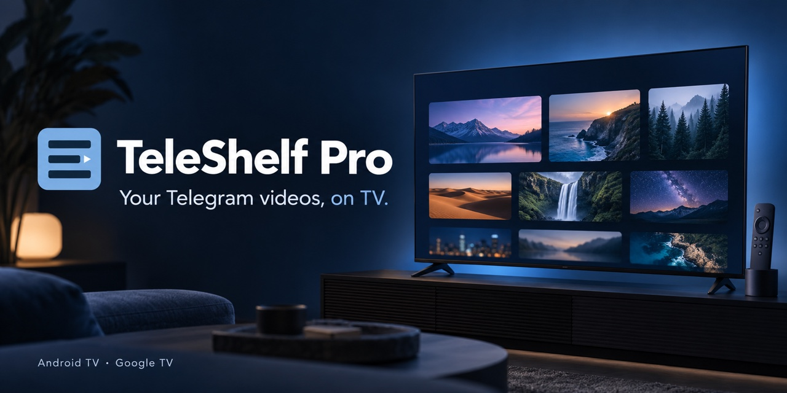
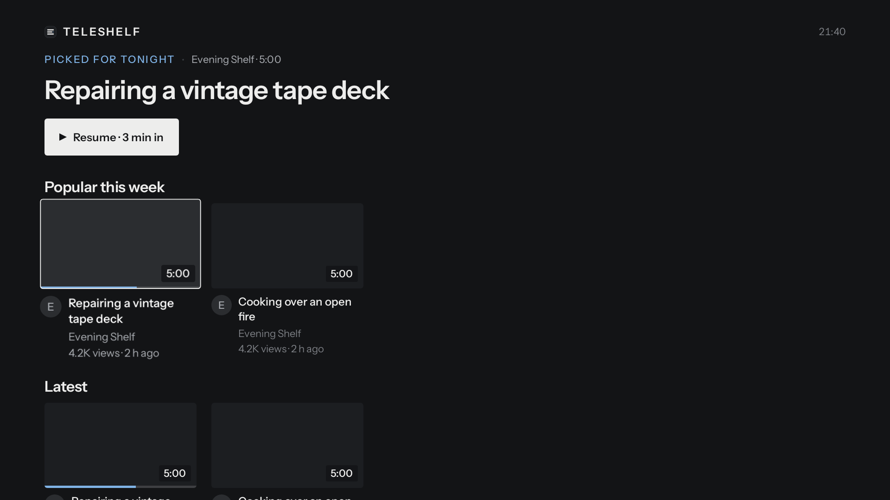
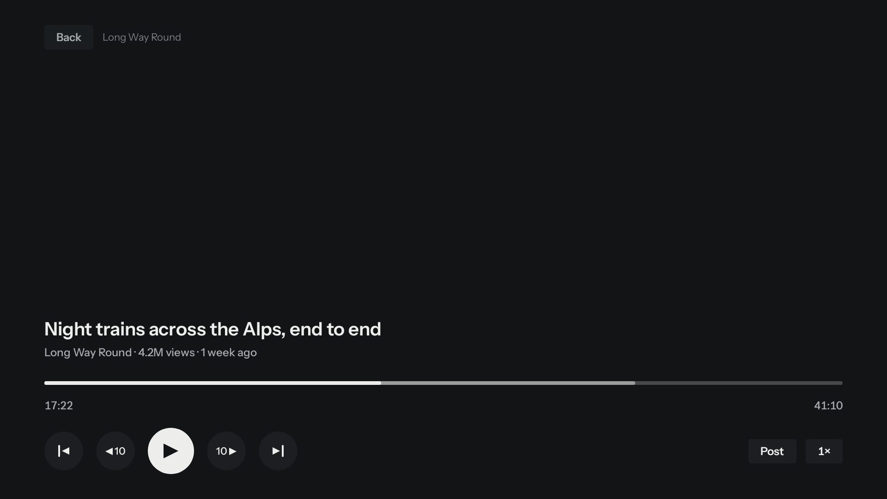
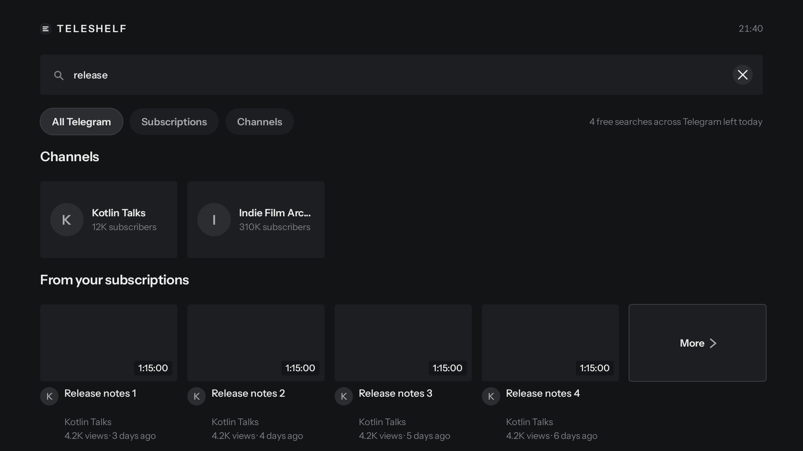
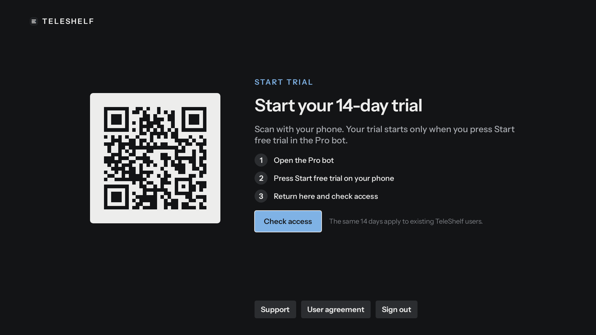

# TeleShelf Pro

**Your Telegram videos, at home on TV.**

Browse the channels you follow as video shelves. Resume where you stopped,
save something for later, and control everything with your TV remote.

[English](README.md) · [Русский](guides/ru.md) · [Português (Brasil)](guides/pt-BR.md) · [Español (Latinoamérica)](guides/es-419.md)

**Favorites** keeps videos for repeat watching. Choose **Add to favorites** in a video’s menu, including during playback, then open Favorites below Watch Later in the side panel. Watching a video or clearing History keeps its favorite; Watch Later remains a separate queue.

**Watched progress:** videos count as watched at 90% of their duration, even if you leave before the final frame. Rewinding below 90% restores resume from that position; autoplay still waits for the video to end.

**Unsupported video formats:** when the TV cannot decode a video's format, the player explains the limitation and offers Back to Home without a useless retry button. Errors that may be temporary still offer Retry.

**Settings:** clearer switches and language/keyboard choices, confirmed quality/autoplay choices, and a cache-size dialog that keeps the slider. Panes remember focus and scrolling; hidden-item removal, cache cleanup and diagnostics show clear errors and retry actions.

**Search keyboard:** a compact keyboard with English plus one selected Russian, Brazilian Portuguese or Latin American Spanish layout. Accents and Ё have dedicated keys, with a separate numbers/symbols page. In Settings → Language → Keyboard languages, choose Automatic, English only, or English plus one of the three languages. Search uses the same choice and keeps focus stable across typing, recent queries and search results.

**Filter channels:** on Channels, open the filter above the grid and type part of a channel name. Matches update as you type, using the same compact keyboard and language choice as Search. Done closes the editor; clearing the filter restores the full list.

**[Download TeleShelf Pro 0.59.0 · build 80](https://github.com/nimec77/teleshelf-pro/releases/latest/download/teleshelf-pro.apk)** · **Downloader code: 6320340**

APK SHA-256:
```text
cd5f95583548151a296499caba9c754dbcc097764d4625037a4e19efcb66fc60
```

**[How to install on your TV](#install-and-sign-in)** · [Check APK availability](https://github.com/nimec77/teleshelf-pro/releases)

The cover is an illustration; the app screenshots below use synthetic data.

[Release availability](https://github.com/nimec77/teleshelf-pro/releases) ·
[Trial, buy or restore](https://t.me/TeleShelfProBot?start=trial) ·
[App support](https://t.me/TeleShelfSupportBot)

Install TeleShelf before starting the trial: the timer starts when you press
**Start free trial** in the Pro bot on your phone.

TeleShelf uses the Telegram API and is an independent, unofficial app. It is
not made or endorsed by Telegram. This repository distributes official APKs;
it does not contain the app's source code.

## A TV view of your channels

- **Home:** popular videos, latest posts and shelves for the channels you follow.
- **Keep your place:** playback resume, History and progress sync through your own Saved Messages.
- **Make a list:** Watch Later for your queue, Favorites for repeat watching, and a reversible Hide watched setting for Home and channel pages.
- **Find a video:** search your subscriptions or use Telegram's free public search quota.
- **Watch comfortably:** quality and speed controls, embedded audio tracks and subtitles when the file provides them.

The following are actual app UI captures rendered with synthetic test data.
Thumbnails and video pictures are absent in these previews. Select an image
to view it at full size.

| Home | Player |
| --- | --- |
| [](assets/screenshots/home.png) | [](assets/screenshots/player.png) |
| **Search** | **Start trial** |
| [](assets/screenshots/search.png) | [](assets/screenshots/trial.png) |

## What you need

An Android TV or Google TV device running **Android 8.0 or later**, with a
32-bit or 64-bit ARM processor, a remote, an internet connection and Telegram
on your phone. Android-based Fire TV devices may run the sideload APK;
device compatibility still needs launch verification. Vega OS, Apple TV
and x86 devices are unsupported by this APK.

The interface is available in English, Russian, Brazilian Portuguese and
Latin American Spanish. TeleShelf plays videos from your own Telegram
account; it does not supply subscriptions or a content catalog.

## Install and sign in

Download the official APK above or use Downloader on the TV.
Install the app before starting the trial.

### Download directly on the TV

1. Install **Downloader by AFTVnews** from your TV's supported app store.
   See the [official Downloader page](https://www.aftvnews.com/downloader/) to
   identify the app. Open Downloader on the TV.
2. Enter **6320340** in Downloader and load it.
3. Downloader downloads **teleshelf-pro.apk**. Alternatively, open the
   [Releases page](https://github.com/nimec77/teleshelf-pro/releases) and choose
   that file under **Assets**. Source-code ZIP/tar.gz files are not installers.
4. When Android asks, allow **Downloader** to install apps. The setting may be
   called **Install unknown apps** or **Unknown sources**; names and locations
   vary by TV. Return to Downloader and open the downloaded APK again if needed.
5. Choose **Install**, then **Open**. For an update, install over the existing
   TeleShelf app to keep your Telegram login, history and settings. Keep its data.

Code **6320340** targets the stable GitHub APK URL. If the shortener is unavailable,
enter the full address in Downloader:

```text
https://github.com/nimec77/teleshelf-pro/releases/latest/download/teleshelf-pro.apk
```

The app and installation process have been successfully tested on a physical
Android TV.

### Transfer from an Android phone

Use this alternative only if [LocalSend](https://localsend.org/download) is
available and usable on your TV (a mouse may be needed):

1. On the phone, open the official Releases page and download the `.apk`
   from **Assets**, or save the [official Telegram APK document](https://t.me/teleshelf_pro/17).
2. Open LocalSend on the Android phone and TV, connected to the same local
   Wi-Fi/network. On the phone, select the APK and send it to the TV; accept
   the transfer on the TV.
3. Open the received APK using LocalSend or the TV's file manager. If prompted,
   allow that app to install APKs, then choose **Install** and **Open**.

LocalSend availability, remote control and opening APKs depend on the TV.
Phone-to-TV transfer using only the remote remains unverified; LocalSend may
need a mouse.
iPhone users should use the direct TV method above.

### Sign in, then start the trial

1. Open TeleShelf on the TV. Use Telegram's device-link QR scanner on your
   phone to scan the TV's login code and confirm the connection. Enter your
   Telegram two-step verification password on the TV if requested.
2. On the phone, open [@TeleShelfProBot](https://t.me/TeleShelfProBot?start=trial)
   with **the same Telegram account**. Press **Start free trial** when you
   are ready to begin the account's 14 days. Installing or opening the bot
   starts nothing.
3. Return to TeleShelf. Choose **Check access** if the access screen remains.
   Existing trial/purchase: send `/restore` to the Pro bot; it preserves the
   original trial deadline.

### Updating and common problems

- **Update:** download the new official APK and install it over TeleShelf.
  There is no automatic updater. Uninstalling removes local app data.
- **Downloaded a ZIP?** Return to **Releases → Assets** and select the APK.
- **Installation is blocked?** Allow the app opening the APK to install apps
  in your TV settings. Check your model supports Android APK installation.
- **App not installed / incompatible?** Check Android 8.0+, an ARM processor
  and the official signing certificate below. Contact support with the TV
  model, Android version and exact error.
- **Access does not appear?** Use the same Telegram account on phone and TV,
  send `/restore` to the Pro bot and choose **Check access** on the TV.

App/install help: [@TeleShelfSupportBot](https://t.me/TeleShelfSupportBot).

## Fourteen days, then a one-time purchase

Every account gets **one 14-day trial**, including previous TeleShelf users.
It starts only when you press **Start free trial** in
[@TeleShelfProBot](https://t.me/TeleShelfProBot?start=trial) on your phone.
Installing the APK or opening the bot starts nothing. Another TV, a reinstall
or `/restore` keeps the original deadline.

After the trial ends, browsing and playback require a **one-time Telegram
Stars purchase**. There is no subscription or continuing free mode. The bot
shows the standard price, **500 Stars worldwide**, before you confirm checkout.
You can buy before starting a trial. A purchase belongs to your Telegram
account and unlocks the app until a signed revocation, such as after a refund.
Read `/terms` in the Pro bot before buying; use `/paysupport` there for payment help.

For a new TV or a missing access message, send `/restore` to the Pro bot on
your phone and choose **Check access** on the TV if needed. Restore does not
restart the trial. Support, the user agreement and sign-out remain available
while content access is locked. The TV never sends bot messages or spends Stars.

## Updates and authenticity

Official release files are available in
[GitHub Releases](https://github.com/nimec77/teleshelf-pro/releases) and as APK
documents in [@teleshelf_pro](https://t.me/teleshelf_pro). News is in
[@teleshelf_tv](https://t.me/teleshelf_tv). Each release identifies its
version and the APK's SHA-256. Both mirrors must contain identical bytes.

Compare the downloaded file's SHA-256 with that release's published hash.
The APK hash changes for every build; the signing certificate identifies
official updates. Its SHA-256 is:

```text
4e5bc630c2a119d9ce22abe9f77a1191be749eac50af3ec4a306214a53fe768c
```

On a computer with Android SDK Build Tools, inspect the certificate with
`apksigner verify --print-certs teleshelf-pro.apk`. Check the
`Signer #1 certificate SHA-256 digest` against the fingerprint above. Use
`shasum -a 256 teleshelf-pro.apk` on macOS, `sha256sum teleshelf-pro.apk` on
Linux or `Get-FileHash .\teleshelf-pro.apk -Algorithm SHA256` in PowerShell
to inspect the file hash. A copy signed with a different certificate is
not an official update and can expose your Telegram session.

## Privacy and help

Videos are fetched directly by your own Telegram session. TeleShelf operates
no server-side media cache or content catalog. The Pro bot retains your
Telegram account id, the original trial dates and purchase records for access
and restore. Optional crash and usage reports are off until you consent.
[Privacy policy](https://github.com/nimec77/teleshelf-pro/blob/main/PRIVACY.md)
(version 1, effective October 18, 2026; English). The in-app user agreement is
available from Support and About.

- App problems and feedback: [@TeleShelfSupportBot](https://t.me/TeleShelfSupportBot).
- Trial, purchase, restore and `/paysupport`: [@TeleShelfProBot](https://t.me/TeleShelfProBot).
- Official files: [@teleshelf_pro](https://t.me/teleshelf_pro).
- News: [@teleshelf_tv](https://t.me/teleshelf_tv).
